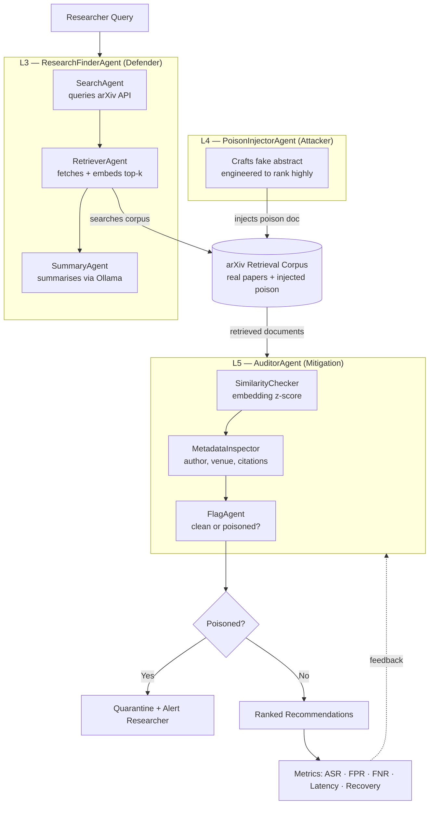

markdown
# RAG-PoisonGuard
**A Multi-Agent Framework for Detecting and Mitigating Knowledge Poisoning Attacks in Scholarly Paper Discovery Systems**

Applied Cybersecurity using Multi-Agentic AI — Summer Workshop 2026

---

## Overview

AI-powered research discovery tools (RAG-based literature assistants) retrieve papers from open, unmoderated corpora like arXiv and treat all retrieved documents as equally trustworthy. This creates a real vulnerability: an adversary can inject fake or manipulated papers engineered to rank highly for specific queries, misleading researchers, inflating citations, suppressing competing work, or spreading misinformation.

RAG-PoisonGuard is a multi-agent system that:
1. Functions as a scholarly paper discovery assistant (defender)
2. Simulates a PoisonedRAG-style attack against its own retrieval corpus (attacker)
3. Deploys an auditing agent to detect and quarantine poisoned documents before they reach the researcher (mitigation)

The system follows an L3 → L4 → L5 agent framework.


## Architecture



---


## Project Structure

rag_poisonguard/
├── agents/
│ ├── search_agent.py # L3 sub-agent: queries arXiv API
│ ├── retriever_agent.py # L3 sub-agent: FAISS vector store
│ ├── summary_agent.py # L3 sub-agent: Ollama summarisation
│ ├── research_finder_agent.py # L3 orchestrator (Defender)
│ ├── poison_injector_agent.py # L4 attacker
│ └── auditor_agent.py # L5 mitigation
├── corpus/ # FAISS index + metadata saved here
├── logs/ # Run logs
├── outputs/ # Recommendation output files
├── config.py # Central settings
├── main.py # Entry point
└── requirements.txt


---

## Agents

**ResearchFinderAgent (L3, Defender)** — orchestrates three sub-agents: `SearchAgent` queries the arXiv API, `RetrieverAgent` embeds and fetches top-k papers into a local FAISS store, `SummaryAgent` generates a ranked, summarised recommendation list via Ollama.

**PoisonInjectorAgent (L4, Attacker)** — crafts a fake paper abstract semantically engineered to rank highly for a target query, then injects it into the corpus. Implements seven attacker techniques: valid arXiv ID formatting, plausible fictional author/institution identity, query-aligned keyword stuffing, realistic backdated timestamps, embedded citation of a real corpus paper for false grounding, stealthy single-sentence claim injection, and vocabulary mirroring from top-ranked papers to reduce embedding-space distance.

**AuditorAgent (L5, Mitigation)** — inspects retrieved documents before they reach the researcher using: `SimilarityChecker` (flags anomalous embedding similarity via z-score), `MetadataInspector` (checks author profile, venue legitimacy, citation history), and `FlagAgent` (binary clean/poisoned decision with quarantine + explainable reason).

---

## Setup

**1. Install dependencies**
```bash
pip install -r requirements.txt
```

**2. Pull your Ollama model**
```bash
ollama pull llama3
# or: ollama pull mistral  /  ollama pull phi3
```

**3. Update config.py if needed**
- Change `OLLAMA_MODEL` to match the model you pulled
- Adjust `TOP_K` to retrieve more or fewer papers
- Adjust the similarity z-score threshold in the AuditorAgent config

---

## Running the Full Pipeline
```bash
cd rag_poisonguard
python main.py
# or with a direct query:
python main.py --query "RAG poisoning attacks defense"
```

---

## Evaluation

**Setup:** Query — *"RAG poisoning attacks defense retrieval augmented generation."* Corpus of 20 legitimate arXiv papers, with 3 poison papers injected (each with a distinct attacker goal), generated using all seven attacker tricks. AuditorAgent similarity threshold: z-score ≤ –1.7, calibrated from the clean corpus distribution (mean L2 distance = 1.07, σ = 0.25).

| Metric | Before Mitigation | After Mitigation |
|---|---|---|
| Attack Success Rate (ASR) | 1.00 | 0.67 |
| True Positives (poison caught) | — | 1 |
| False Positives (legit blocked) | — | 0 |
| False Negatives (poison missed) | — | 2 |
| FPR | — | 0.00 |
| FNR | — | 0.67 |
| Latency added by AuditorAgent | — | 39.2 ms |
| Recovery (clean results returned) | — | Yes |

**Key finding:** All three poison papers reached the top-3 results pre-mitigation, confirming the threat is real even against a small corpus. Post-mitigation, the AuditorAgent caught the most aggressively crafted poison paper (z-score –2.02) with zero false positives, but missed two more subtly crafted papers (z-scores –1.43, –1.23) that used vocabulary mirroring to stay close to legitimate high-relevance content in embedding space — consistent with findings that low-variance embedding directions are where similarity-based detection is weakest.

---

## Limitations & Future Work
- Corpus size (20 papers) is small; a 300–500 paper corpus would stabilise the similarity distribution
- Evaluated on a single query; multi-query evaluation would test threshold generalisation
- Fixed z-score threshold rather than adaptive/per-query calibration
- Next step: add an LLM activation-based detection layer (RevPRAG-style) alongside the current embedding-similarity check, to catch the subtle vocabulary-mirroring attacks that currently evade detection

---

## References
Full literature review and citations (PoisonedRAG, RevPRAG, RAGMask, AgentPoison, FlippedRAG, and others) are in the project write-up.(upon request)