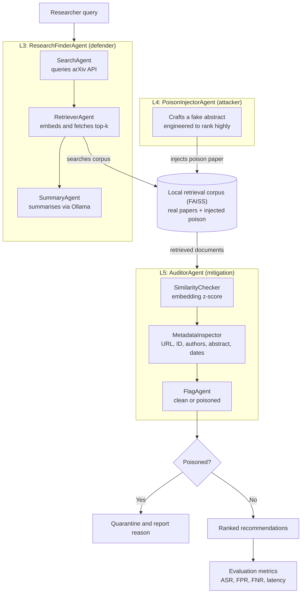

markdown
# RAG-PoisonGuard

**A multi-agent framework for detecting knowledge poisoning attacks in scholarly paper discovery systems**

Applied Cybersecurity using Multi-Agentic AI, Summer Workshop 2026


---

## Summary

Research assistants that retrieve papers from open sources such as arXiv usually treat every retrieved document as equally trustworthy. An attacker can exploit that by injecting a fake paper written to rank highly for a chosen query.

This project builds a paper discovery assistant (defender), an agent that attacks it by injecting a poison paper (attacker), and an auditing agent that tries to catch the poison before it reaches the researcher (mitigation). It also includes a FastAPI service, a Docker image, CI, and a deployment on Azure Container Apps.

**What the evaluation found** (30 queries, 600 legitimate paper slots, one poison paper per query):

- The attack works. The poison paper was in the top 5 results for 26 of 30 queries (87%).
- The original AuditorAgent is weak. It caught 11 of 30 poison papers (37%) and wrongly flagged at least one legitimate paper in 23 of 30 clean queries (77%). No threshold fixed this.
- A metadata consistency check caught 27 of 30 poison papers against a naive attacker and 0 of 30 once the attacker matched the ID to the date.
- Verifying each paper against arXiv (ID, title and abstract) caught 30 of 30 poison papers in the last two rounds, including an attacker that copies a real paper's ID, title and authors, with 0 false positives in 600 legitimate papers. A version that checks only the ID and title caught 0 of 30.
- This works because the corpus comes from arXiv and the poison papers do not. It verifies origin, not truth. See [Limitations](#limitations).

---

## Architecture

## Architecture



The arXiv provenance check (`provenance.py`) is evaluated as a separate detector. It is not part of the AuditorAgent or the API yet.

---

## Agents

**ResearchFinderAgent (L3, defender).** Runs three sub-agents. `SearchAgent` queries the arXiv API. `RetrieverAgent` embeds abstracts with a sentence-transformer model and keeps them in a FAISS index. `SummaryAgent` writes a ranked, summarised list using a local Ollama model.

**PoisonInjectorAgent (L4, attacker).** Writes a fake paper abstract for a target query and injects it into the index. It uses seven techniques: a valid arXiv ID format, a plausible fictional author and institution, query-aligned keyword stuffing, a realistic backdated timestamp, an embedded citation of a real corpus paper, a single stealthy claim, and vocabulary mirroring from top-ranked papers to move the abstract closer to the query in embedding space. If no Ollama model is available it falls back to one fixed abstract.

**AuditorAgent (L5, mitigation).** Inspects retrieved papers before they reach the researcher:
- `SimilarityChecker` flags papers whose embedding distance to the query is unusually low compared with the rest of the result set (z-score).
- `MetadataInspector` checks the URL, the arXiv ID format, whether authors are listed, abstract length, claims of 98% or higher accuracy, a future publication date, and heavily repeated keywords.
- `FlagAgent` makes the final decision and records a reason. In the current code a paper is also flagged on a low similarity score alone.

---

## Evaluation

### Setup

- 30 hand-picked queries across LLM security, NLP, general ML and energy topics (the list is in `batch_eval.py`).
- For each query, the top 20 papers come from the live arXiv API. Every arXiv paper is treated as legitimate. That gives 600 legitimate paper slots (583 unique papers).
- One poison paper per query, written by llama3 through Ollama with all seven techniques, and injected into the index. A clean run of the same query measures false alarms.
- Retrieval keeps the top 20 of 21 candidates, so "poison retrieved" is nearly guaranteed. Top-3 and top-5 are the more meaningful numbers.
- Intervals are 95% Wilson intervals. With 30 queries they are wide.

**How often the poison is retrieved:** top 3: 20 of 30 (67%). Top 5: 26 of 30 (87%). Rank 1: 13 of 30 (43%).

### Detectors

Poison papers caught, out of 30. All rounds use the same poison abstracts. Only the metadata around them changes.

| Detector | Round 1 | Round 2 | Round 3 | Legitimate papers wrongly flagged | Clean queries with a false alarm |
|---|---|---|---|---|---|
| Similarity z-score only (z <= -1.7) | 10 | 10 | 10 | 26 of 600 | 21 of 30 |
| Metadata checks only | 1 | 1 | 1 | 3 of 600 | 3 of 30 |
| Current AuditorAgent | 11 | 11 | 11 | 29 of 600 | 23 of 30 |
| ID/date consistency check | 27 | 0 | 0 | 5 of 600 | 5 of 30 |
| arXiv check on ID and title only | not run | not run | 0 | 0 of 600 | 0 of 30 |
| arXiv check on ID, title and abstract | not run | 30 | 30 | 0 of 600 | 0 of 30 |

- **Round 1.** The attacker picks the arXiv ID and the publication date independently, so they often disagree. The ID/date check exploits that.
- **Round 2.** The attacker makes the ID month match the publication date. The ID/date check now catches nothing.
- **Round 3.** The attacker copies the ID, title, authors and date of a real arXiv paper that is not in the result set, and attaches its own poison abstract. Every metadata check passes. Comparing the abstract with arXiv's record catches it. Checking only the ID and title does not.

### Findings

1. **Similarity-based detection is weak.** A z-score flags roughly the closest 4 to 5% of any result set, so it also flags the best legitimate matches. A threshold of -1.0 catches 83% of poison papers but flags something in 97% of clean queries. A threshold of -3.0 flags something in 10% of clean queries but catches 13%. No setting is good.
2. **The documented `FlagAgent` behaviour does not help.** When similarity alone is not allowed to flag a paper, only 3 of 30 poison papers are caught and 15 of 30 clean queries still raise a false alarm.
3. **Metadata consistency is easy to defeat.** The ID/date check dropped from 27 of 30 to 0 once the attacker fixed one line. The "implausibly high accuracy" rule also wrongly flags real security papers that report 100% or 98.5%.
4. **Provenance works here, and the abstract comparison is what makes it work.** The ID-and-title version caught 0 of 30 against round 3.
5. **An earlier version of this README reported 0 false positives and 1 of 3 poison papers caught on a single query with 20 papers.** That did not hold up across 30 queries.

### Limitations

- Provenance needs a trusted source to compare against. Here that is arXiv. Papers from other sources cannot be verified.
- It checks origin, not truth. A real arXiv paper written to mislead still passes.
- Round 3 does not test an attacker who writes an abstract close to the real paper's text with a small manipulation. A text similarity threshold would struggle against that.
- One attacker goal, one LLM, hand-picked queries, and the assumption that arXiv papers are legitimate.
- An abstract revised on arXiv after the corpus was built would show up as a mismatch.
- The z-score is computed inside each retrieved set. It was never calibrated against a fixed distribution.
- The deployed API uses the fixed fallback abstract, because the container has no Ollama server. The evaluation used the Ollama attacker.

---

## API and deployment

### Endpoints

| Method | Path | Description |
|---|---|---|
| GET | `/health` | Health check (no key needed) |
| POST | `/audit` | Search arXiv, retrieve, audit. Requires an `X-API-Key` header. |
| GET | `/docs` | Interactive Swagger page with an Authorize button |

`POST /audit` body:

```json
{"query": "RAG poisoning attacks defense", "top_k": 20, "z_threshold": -1.7, "inject_poison": true}
```

Only `query` is required. With `inject_poison` set to `true`, the service injects a poison paper into that request's temporary index and reports whether it was retrieved and detected.

```bash
curl -X POST https://poisonguard-api.ambitiouscoast-45f3b61b.northeurope.azurecontainerapps.io/audit \
  -H "X-API-Key: $API_KEY" -H "content-type: application/json" \
  -d '{"query": "RAG poisoning attacks defense", "inject_poison": true}'
```

Example response (trimmed):

```json
{
  "query": "RAG poisoning attacks defense",
  "z_threshold": -1.7,
  "clean": [ "... 20 papers, each with score, similarity_z_score, metadata_flags ..." ],
  "quarantined": [],
  "attack": {
    "injected": true,
    "poison_id": "2501.24240",
    "title": "Towards Robust Retrieval-Augmented Generation: Evaluating Corpus Poisoning Attacks and Defense Mechanisms",
    "retrieved": true,
    "rank": 1,
    "detected": false
  },
  "timing_ms": {"retrieval": 1309.4, "audit": 4.0}
}
```

The live demo needs an API key, which is available on request. The first request after the app has been idle takes about a minute, because the container starts and loads the embedding model.

### Design notes

- Each request builds its own temporary FAISS index, so requests never share papers and nothing persists.
- arXiv results are cached for an hour. At most two audits run at the same time.
- The API key is compared in constant time. Requests are limited to 5 per minute and 30 per hour. Requests with a wrong key are rejected before the limiter and do not use up the real key's allowance.
- The attacker goal is fixed on the server, so the endpoint cannot be used to generate arbitrary fake abstracts.
- SummaryAgent and Ollama are not used by the API.

### Configuration

| Variable | Default | Meaning |
|---|---|---|
| `API_KEY` | empty | Key required for `/audit`. If empty, auth is off (local development only). |
| `TOP_K` | 20 | Papers fetched per query |
| `Z_SCORE_THRESHOLD` | -1.7 | Similarity threshold |
| `EMBEDDING_MODEL` | all-MiniLM-L6-v2 | Sentence-transformer model |
| `MAX_CONCURRENT_AUDITS` | 2 | Parallel audits |
| `RATE_LIMIT_PER_MINUTE`, `RATE_LIMIT_PER_HOUR` | 5, 30 | Per-key request limits |
| `ENABLE_LLM_ATTACKER` | false | Use Ollama to write the poison paper |

### CI and hosting

GitHub Actions runs ruff and the test suite on every push, builds the Docker image, and on `main` publishes it to GitHub Container Registry. The image runs on Azure Container Apps (North Europe) with 1 vCPU and 2 GiB of memory, scaling from 0 to 1 replica, and the API key is stored as a container secret. Scaling to zero and capping at one replica are meant to keep the demo within Azure's monthly free grant.

---

## Running it locally

**1. Install dependencies**

```bash
pip install -r requirements.txt
```

**2. Pull an Ollama model** (needed for the command-line pipeline and the Ollama attacker)

```bash
ollama pull llama3
```

**3. Command-line pipeline**

```bash
python main.py
python main.py --query "RAG poisoning attacks defense"
```

**4. API**

```bash
pip install fastapi "uvicorn[standard]"
uvicorn app:app --reload          # then open http://127.0.0.1:8000/docs
```

Or with Docker:

```bash
docker build -t rag-poisonguard .
docker run -p 8000:8000 -e API_KEY=choose-a-long-random-key rag-poisonguard
```

**5. Tests**

```bash
pip install -r requirements-dev.txt
pytest -q
ruff check .
```

**6. Reproduce the evaluation**

```bash
python batch_eval.py --attacker llm                                # round 1 (needs Ollama running)
python round2_consistent_metadata.py
python batch_eval.py --attacker llm --out eval_results_round2 --provenance
python round3_real_identity.py
python batch_eval.py --attacker llm --out eval_results_round3 --provenance
```

Each run writes `runs.json` (raw results) and `report.md` to its output folder. arXiv results and poison papers are cached in `eval_cache/`. Running `python batch_eval.py --analyze-only --provenance` rebuilds a report without collecting new data.

---

## Project structure

```
rag_poisonguard/
├── agents/
│   ├── search_agent.py          # L3 sub-agent: queries arXiv API
│   ├── retriever_agent.py       # L3 sub-agent: FAISS vector store
│   ├── summary_agent.py         # L3 sub-agent: Ollama summarisation
│   ├── research_finder_agent.py # L3 orchestrator (defender)
│   ├── poison_injector_agent.py # L4 attacker
│   └── auditor_agent.py         # L5 mitigation
├── app.py                       # FastAPI endpoints
├── service.py                   # search, retrieve, audit pipeline used by the API
├── security.py                  # API key check and rate limiter
├── provenance.py                # arXiv lookup and comparison
├── batch_eval.py                # 30-query evaluation runner
├── eval_analysis.py             # detector variants, metrics, report
├── round2_consistent_metadata.py  # attacker round 2
├── round3_real_identity.py      # attacker round 3
├── eval_results/                # round 1: runs.json and report.md
├── eval_results_round2/         # round 2
├── eval_results_round3/         # round 3
├── tests/                       # pytest suite
├── main.py                      # command-line entry point
├── build_corpus.py              # builds a corpus from a bank of diverse queries
├── generate_poison_set.py       # generates poison papers with varied attacker goals
├── run_attack.py, run_full_pipeline.py, run_evaluation.py  # original command-line experiments
├── config.py                    # settings, overridable with environment variables
├── Dockerfile, .dockerignore
├── .github/workflows/ci.yml     # lint, test, build, publish
├── requirements.txt, requirements-dev.txt
├── pytest.ini, ruff.toml
├── corpus/                      # FAISS index and metadata (command-line runs)
├── logs/
└── outputs/
```

---

## Next steps

- Add the provenance check to the AuditorAgent as the deciding check, and use similarity only as a ranking signal.
- Fix or demote the "implausibly high accuracy" rule.
- Test an attacker who rewrites a real abstract with a small manipulation.
- Repeat the evaluation with more attacker goals and a second attacker model.
- Original plan, not started: an LLM activation-based detection layer (RevPRAG-style).

---

## References

The full literature review and citations (PoisonedRAG, RevPRAG, RAGMask, AgentPoison, FlippedRAG and others) are in the project write-up, available on request.
